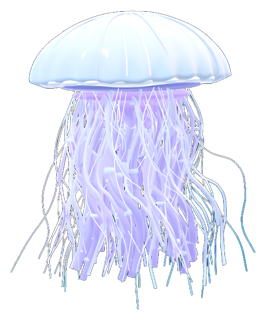
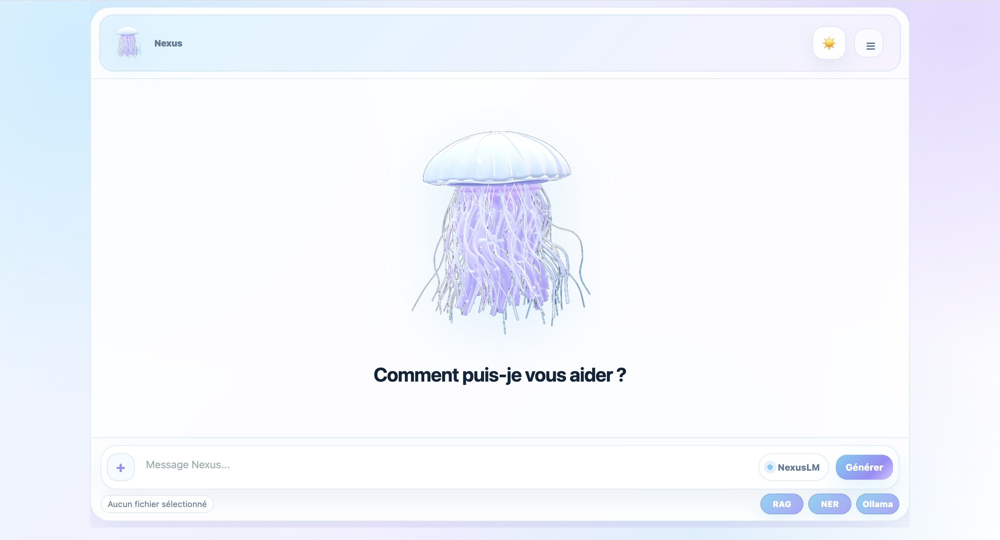
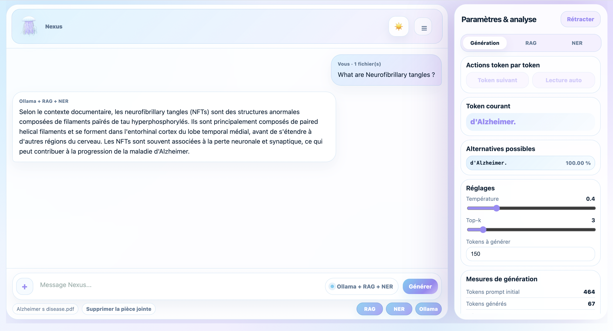

  

<h1 align="center">NexusLM</h1>

  A small generative language model built from scratch and trained on biomedical abstracts, 
  extended with biomedical NER, local RAG and a Flask web interface.

  <em>Master's research project (TER) — M1 Computer Science, Université de Montpellier — Feb. to June 2026</em>

---

## Overview

NexusLM is a Transformer language model written from scratch with TensorFlow / Keras.
We first trained it on a short literary text to check that it learns, then on a large corpus of PubMed abstracts to make it produce biomedical vocabulary.

Because a small model alone tends to invent facts, we extended it into a local document assistant:

- **NER**: detects chemicals and diseases in medical text (BiomedBERT fine-tuned on BC5CDR).
- **RAG**: retrieves the most relevant passages from the user's documents (TF-IDF + cosine similarity).
- **Local generation with Ollama** (`llama3.2`) to write a readable answer from the retrieved passages.
- **Flask web app** that brings everything together. Documents never leave the user's machine.

We also ran a **user-needs survey** among pharmaceutical professionals to check that a 100 % local tool answered a real need (confidentiality constraints, large volumes of PDF reports).

> 🎥 **Demo video:** [watch the app in action on YouTube](https://youtu.be/1dMx-s_7TbM)

---

  
  

<em>Left: home screen. Right: answer generated from an uploaded PDF (Ollama + RAG + NER).</em>

---

## What we built, step by step

| Step | What | Notebook |
|---|---|---|
| 1 | Toy self-attention in NumPy, then as a Keras layer, to understand the mechanism | [`01_NexusLM_from_scratch`](notebooks/01_NexusLM_from_scratch.ipynb) |
| 2 | Tokenisation, vocabulary, training sequences (window of 32 tokens → next token) | `01` |
| 3 | NexusLM: token and positional embeddings, multi-head attention, causal mask, Transformer blocks | `01` |
| 4 | Sanity check on *Alice's Adventures in Wonderland* (public domain) | `01` |
| 5 | Training on PubMed abstracts, learning curves, text generation with temperature | `01` |
| 6 | Biomedical NER and TF-IDF retriever for RAG | [`02_NER_and_RAG`](notebooks/02_NER_and_RAG.ipynb) |
| 7 | Gradio interface comparing a WikiText model and the PubMed model on the same prompt | [`03_Interface_WikiText_vs_PubMed`](notebooks/03_Interface_WikiText_vs_PubMed.ipynb) |
| 8 | Analysis of the user-needs survey (pandas, matplotlib) | [`04_User_needs_survey`](notebooks/04_User_needs_survey.ipynb) |
| 9 | Local Flask web app: NexusLM + RAG + NER + Ollama | [`app/`](app/) |

---

## Model and data

| | |
|---|---|
| Architecture | Decoder-only Transformer, 2 blocks, 4 attention heads, embedding size 128, feed-forward size 256 |
| Context window | 32 tokens |
| Vocabulary | 30,000 words |
| Training corpus | 25,000 PubMed abstracts, about 4.3 million tokens |
| Training set | 2 million sequences (46 % of the 4.3 million possible) |
| Training | Adam (lr = 1e-3), sparse categorical cross-entropy, early stopping |

## Results and what we learned

- **On Alice**, the model reached high training accuracy but low validation accuracy: the text is too short, so the model memorises it. This step was useful to validate the architecture and to observe overfitting in practice.
- **On PubMed**, with far more data, training and validation curves stay much closer. Next-word validation accuracy is about 21 % over a 30,000-word vocabulary (early stopping at epoch 4). The model produces fluent biomedical vocabulary, but, as expected for its size, not reliable facts.
- This is why we added **RAG**: answers are grounded in real documents instead of relying on the model's memory.
- The survey confirmed three needs: large volumes of documents, repetitive tasks (summaries, information search), and strong confidentiality constraints that rule out cloud AI for part of the respondents.

---

## Tech stack

`Python` · `TensorFlow / Keras` · `NumPy` · `pandas` · `matplotlib` · `scikit-learn` · `Hugging Face Transformers` · `PyTorch (NER inference)` · `Flask` · `Gradio` · `Ollama` · `Google Colab`

---

## Running the web app

See [`app/README.md`](app/README.md) for the full setup (Python 3.10 or 3.11, virtual environment, Ollama).

The trained model files are too large for GitHub and are not included in this repository:

- `app/models/nexus_pubmed_big/model.weights.h5` (about 96 MB): [download from Google Drive](https://drive.google.com/file/d/13_Uyt9MltoyDJCr8jK8OeVAxFiBk2I6G/view?usp=sharing).
- `app/models/biomedbert_ner_bc5cdr/`: see [`app/models/README.md`](app/models/README.md).

The vocabulary (`vocab_pubmed_big.pkl`) and the model configuration are included.

---

## Team

Project carried out by a team of five students, who worked together on every stage: the model, NER and RAG, the web app and the user-needs survey:

- Chirine El Aidouni
- Nassera Nabgaoui
- Ilham Akrafi
- Salma Taghnakt
- Akidat Moussa-Nizar

## Disclaimer

Nexus is an experimental student prototype. It is not a validated medical tool and must not be used for diagnosis or medical decisions.
